<div align="center">



<br />

[](https://portfolio-rodrigo-pink.vercel.app)
[](https://react.dev/)
[](https://vite.dev/)
[](https://github.com/rodrigosouzafeliciano/curriculo-online)
[](https://www.linkedin.com/in/rodrigosouzafeliciano/)

</div>

---

## 🌎 Overview (EN-US) · Visão Geral (PT-BR)

<table>
<tr>
<td width="50%" valign="top">

### 🇺🇸 English (EN-US)

Interactive developer portfolio built with **React 19.1** and **Vite 6.3**, deployed continuously on **Vercel**. Designed around a retro-terminal CRT aesthetic with modular CSS tokens and a single-source-of-truth data layer (`src/data/profileData.js`).

- **Single Source of Truth:** All profile bio, experience timelines, categorized skills, education credentials, and contact links are driven from `src/data/profileData.js`.
- **Interactive Tech Filter:** Instant client-side filtering across `TODOS`, `FRONTEND`, `MOBILE`, `BACKEND`, `DEVOPS`, and `DATA_QA`.
- **Zero UI Bloat:** Pure React 19 + custom CSS variables (`variables.css`, `components.css`, `animations.css`) with zero external UI component dependencies.
- **Direct CV Download:** Integrated CTAs serving the latest ATS-verified PDF resume from `/public/docs/`.

</td>
<td width="50%" valign="top">

### 🇧🇷 Português (PT-BR)

Portfólio interativo desenvolvido com **React 19.1** e **Vite 6.3**, com deploy contínuo na **Vercel**. Projetado com estética de terminal retrô CRT, tokens CSS modulares e camada única de dados (`src/data/profileData.js`).

- **Fonte Única de Verdade:** Bio, linha do tempo de experiência, tecnologias categorizadas, formação acadêmica e links de contato centralizados em `src/data/profileData.js`.
- **Filtro Interativo de Tecnologias:** Filtragem instantânea por domínio (`TODOS`, `FRONTEND`, `MOBILE`, `BACKEND`, `DEVOPS` e `DATA_QA`).
- **Alta Performance (Zero-Bloat):** Construído com React 19 e CSS modular puro, sem bibliotecas externas de componentes.
- **Download Direto de Currículo:** Botões de ação (CTAs) integrados para baixar o currículo em PDF atualizado diretamente de `/public/docs/`.

</td>
</tr>
</table>

---

## 📂 Project Architecture · Estrutura do Projeto

```text
portfolio-rodrigo/
├── assets/
│   └── portfolio-banner.svg          # Animated SVG repository header
├── public/
│   ├── docs/
│   │   └── Currículo - Rodrigo S. Feliciano.pdf
│   └── favicon.svg
├── src/
│   ├── components/
│   │   ├── Navbar.jsx                # Fixed terminal navigation bar
│   │   ├── ScrollProgress.jsx        # Real-time scroll progress indicator
│   │   ├── CRTOverlay.jsx            # Scanline & CRT monitor visual layer
│   │   ├── HeroSection.jsx           # Typewriter prompt + primary CTAs
│   │   ├── AboutSection.jsx          # Engineering bio + metric cards
│   │   ├── TechSection.jsx           # Filterable Full Stack technology grid
│   │   ├── ExperienceSection.jsx     # Career & flagship project timeline
│   │   ├── EducationSection.jsx      # Higher Education (ADS) & SENAC qualifications
│   │   ├── SkillsSection.jsx         # Core engineering competencies (Bento Grid)
│   │   ├── LanguagesSection.jsx      # Language proficiency cards
│   │   ├── ContactSection.jsx        # Direct contact channels + CV download
│   │   └── Footer.jsx                # Terminal footer
│   ├── data/
│   │   └── profileData.js            # Centralized profile data source
│   ├── styles/
│   │   ├── variables.css             # Design tokens & neon color palette
│   │   ├── global.css                # Reset, base typography & layout
│   │   ├── components.css            # Terminal windows, buttons, cards & grids
│   │   └── animations.css            # Keyframe animations & glitch effects
│   ├── App.jsx
│   └── main.jsx
├── index.html
├── package.json
└── vite.config.js
```

---

## 🚀 Quick Start · Como Executar

```bash
# Clone the repository / Clone o repositório
git clone https://github.com/rodrigosouzafeliciano/portfolio-rodrigo.git
cd portfolio-rodrigo

# Install dependencies / Instale as dependências
npm install

# Start development server / Inicie o servidor de desenvolvimento
npm run dev

# Build for production / Gere o build de produção
npm run build
```

---

<div align="center">

**Rodrigo Souza Feliciano** · Full Stack Software Developer & QA Analyst  
[Live Portfolio](https://portfolio-rodrigo-pink.vercel.app) · [LinkedIn](https://www.linkedin.com/in/rodrigosouzafeliciano/) · [Online Resume](https://github.com/rodrigosouzafeliciano/curriculo-online) · [Email](mailto:rodrigo.souza.f3liciano@gmail.com)

</div>
